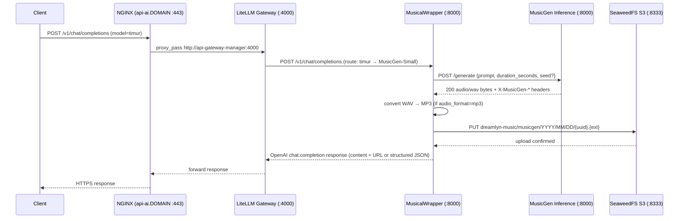

# Musical AI Infrastructure — API Specification

This document describes the Musical AI pipeline exposed by the Dreamlyn server infrastructure. It is intended for developers building client applications that need to integrate text-to-music generation into their products.

The public API is fully compatible with the **OpenAI Chat Completions** format. Any HTTP client or OpenAI SDK can call it without modification beyond setting the base URL and model name.

---

## Table of Contents

1. [Overview](#1-overview)
2. [Architecture](#2-architecture)
3. [Pipeline Components](#3-pipeline-components)
4. [API Reference](#4-api-reference)
5. [Infrastructure Configuration Reference](#5-infrastructure-configuration-reference)
6. [Integration Examples](#6-integration-examples)
7. [Audio File Access](#7-audio-file-access)
8. [Limitations and Notes](#8-limitations-and-notes)

---

## 1. Overview

The Musical AI service converts a **plain-text prompt** into a short piece of music and returns a **public URL** to the generated audio file. The pipeline is built on top of [Meta's MusicGen](https://huggingface.co/facebook/musicgen-small) model and is accessed through a standard OpenAI-compatible chat completions endpoint.

**Key characteristics:**

- Single public endpoint: `POST https://api-ai.{DOMAIN}/v1/chat/completions`
- Model identifier (as seen by client): `timur`
- Output: a URL to a generated audio file stored in S3-compatible object storage
- Supported audio formats: `wav`, `mp3`
- Configurable duration: 5–7 seconds (default 6 s, as configured in the current deployment)
- Two response modes: human-readable text (`user`) or structured JSON (`device`)
- Full SSE streaming support

---

## 2. Architecture

### 2.1 Request Flow

```
Client ──HTTPS──► NGINX ──HTTP──► LiteLLM ──HTTP──► MusicalWrapper ──HTTP──► MusicGen
                                                            │                    │
                                                            │◄── WAV bytes ──────┘
                                                            │
                                                     [optional MP3 conversion]
                                                            │
                                                            ▼
                                                        SeaweedFS S3
                                                            │
                                                    public URL returned
                                                            │
                                                            ▼
                                            MusicalWrapper ──► LiteLLM ──► NGINX ──► Client
```

### 2.2 Sequence Diagram



### 2.3 Internal Docker Network

All services communicate over the `dreamlyn_mesh` Docker bridge network. No service except NGINX is exposed to the public internet directly. The MusicalWrapper is not reachable via any public hostname — all traffic must enter through `api-ai.{DOMAIN}`.

---

## 3. Pipeline Components

### 3.1 NGINX (Public Gateway)

| Property | Value |
|---|---|
| Container | `server` |
| Image | `nginx:latest` |
| Public ports | `80` (→ 301 redirect), `443` (TLS) |
| AI endpoint hostname | `api-ai.{DOMAIN}` |
| Backend | `http://api-gateway-manager:4000` |
| Read timeout | `proxy_read_timeout 300` (5 minutes) |
| TLS | Let's Encrypt certificates via Certbot |

NGINX terminates TLS and proxies all requests to `api-ai.{DOMAIN}` toward LiteLLM. There is no per-path routing for music — all AI traffic (text, vision, music) shares the same public hostname. The music-specific routing happens inside LiteLLM based on the `model` field.

Requests to unknown hosts on port 80 or 443 return HTTP `444` (connection closed).

**Source:** [`Services/Servers/NGINX/Config/nginx.conf.template`](Services/Servers/NGINX/Config/nginx.conf.template)

---

### 3.2 LiteLLM (AI API Gateway)

| Property | Value |
|---|---|
| Container | `api-gateway-manager` |
| Image | `ghcr.io/berriai/litellm:main-latest` |
| Internal port | `4000` |
| Config file | `Services/Gateways/LiteLLM/Manager/config.yaml` |
| Auth | `LITELLM_MASTER_KEY` (Bearer token) |
| UI | Enabled (accessible via the same port) |

LiteLLM acts as a model router. It maps the client-facing model name (`timur`) to the internal MusicalWrapper service. The full model registry configured in this deployment:

| LiteLLM alias | Underlying model | Backend |
|---|---|---|
| `mike` | `openai/Qwen3-4B` | `http://ai-text-qwen3_4b:8000/v1` |
| `diana` | `openai/Qwen3-VL-2B` | `http://ai-vision-qwen3_vl_2b:8000/v1` |
| `timur` | `openai/MusicGen-Small` | `http://api-gateway-musical_wrapper:8000/v1` |

When a client requests `model: "timur"`, LiteLLM forwards the entire OpenAI-format request body to `http://api-gateway-musical_wrapper:8000/v1/chat/completions` unchanged.

**Source:** [`Services/Gateways/LiteLLM/Manager/config.yaml`](Services/Gateways/LiteLLM/Manager/config.yaml)

---

### 3.3 MusicalWrapper (Music Request Adapter)

| Property | Value |
|---|---|
| Container | `api-gateway-musical_wrapper` |
| Build context | `Services/Gateways/MusicalWrapper` |
| Internal port | `8000` |
| Framework | FastAPI + uvicorn |
| Runtime | Python 3.12 |

The MusicalWrapper is a FastAPI application that bridges the OpenAI Chat Completions protocol and the MusicGen inference service. Its responsibilities:

1. **Prompt extraction** — reads the last `user` message from `messages`. Supports both plain string content and multimodal content arrays (extracts `type=text` parts).
2. **Parameter resolution** — reads `duration_seconds`, `seed`, `audio_format`, and `output_mode` from `extra_body` (priority), then from top-level request fields. Falls back to config defaults.
3. **Validation** — enforces duration bounds, audio format allowlist (`wav`, `mp3`), and output mode allowlist (`user`, `device`).
4. **MusicGen call** — `POST {musicgen_api_base}/generate` with `prompt`, `duration_seconds`, and optional `seed`. Timeout is `max(60s, duration_seconds × 20)`.
5. **Audio conversion** — if `audio_format=mp3`, converts the WAV bytes to MP3 using `ffmpeg` (quality preset `-q:a 2`).
6. **S3 upload** — stores the audio file in SeaweedFS S3 under key `{s3_prefix}/YYYY/MM/DD/{uuid}.{format}`. Ensures the target bucket exists before uploading.
7. **Response building** — returns an OpenAI-format `chat.completion` or `chat.completion.chunk` stream. Content format depends on `output_mode` (see [Section 4](#4-api-reference)).

**Health check endpoint:** `GET /healthz` — returns current config state (musicgen backend URL, bucket name, public base URL).

**Source:** [`Services/Gateways/MusicalWrapper/app.py`](Services/Gateways/MusicalWrapper/app.py)

---

### 3.4 MusicGen Inference Service

| Property | Value |
|---|---|
| Container | `inference-music-musicgen_small` |
| Build context | `AI/Models/Music` |
| Internal port | `8000` |
| Framework | FastAPI + uvicorn |
| Base image | `pytorch/pytorch:2.10.0-cuda13.0-cudnn9-runtime` |
| HuggingFace model | `facebook/musicgen-small` |
| Served model name | `MusicGen-Small` |
| Guidance scale | `3.0` |
| Maximum duration | `30 seconds` |
| Max new tokens (at max duration) | `1503` |
| Device | CUDA (GPU); falls back to CPU if unavailable |

The inference service loads `facebook/musicgen-small` at startup via HuggingFace Transformers. It exposes a single generation endpoint:

**`POST /generate`**

Request body:
```json
{
  "prompt": "upbeat jazz with trumpet",
  "duration_seconds": 6.0,
  "seed": 42
}
```

Response: raw `audio/wav` bytes with diagnostic response headers:

| Header | Description |
|---|---|
| `X-MusicGen-Sample-Rate` | Sample rate of generated audio (e.g., `32000`) |
| `X-MusicGen-Max-New-Tokens` | Tokens generated for the requested duration |
| `X-Served-Model-Name` | `MusicGen-Small` |
| `X-Model-Config` | JSON with `model_name`, `guidance_scale`, `max_duration_seconds` |
| `X-MusicGen-Seed` | Echo of the seed, if one was provided |

Token count is scaled linearly from the requested duration against `max_duration_seconds`. The service also exposes `GET /healthz` and `GET /v1/models` for readiness checks.

**Source:** [`AI/Models/Music/app.py`](AI/Models/Music/app.py), [`AI/docker-compose.yml`](AI/docker-compose.yml)

---

### 3.5 SeaweedFS S3 (Object Storage)

| Property | Value |
|---|---|
| Container | `storage-file_storage-s3_provider` |
| Image | `chrislusf/seaweedfs:latest` |
| Internal port | `8333` |
| Public hostname | `s3.{DOMAIN}` (HTTPS, no auth required) |
| S3 config | `Services/Storages/Seaweed/config/s3.json` |
| Music bucket | `dreamlyn-music` |
| Key prefix | `musicgen` |

SeaweedFS provides S3-compatible object storage. The MusicalWrapper uploads audio files using `boto3` with S3v4 signatures. The public `s3.{DOMAIN}` hostname is served by NGINX, which proxies to `swfs-s3:8333` without authentication — generated audio URLs are **publicly readable** by anyone who has the URL.

The S3 identity used by MusicalWrapper is configured via `STORAGE_MUSIC_USER_LOGIN` / `STORAGE_MUSIC_USER_PASSWORD` environment variables (mapped as AWS access key / secret key respectively).

**Source:** [`Services/Gateways/MusicalWrapper/config.yml.example`](Services/Gateways/MusicalWrapper/config.yml.example), [`Services/docker-compose.yml`](Services/docker-compose.yml)

---

## 4. API Reference

### 4.1 Endpoint

```
POST https://api-ai.{DOMAIN}/v1/chat/completions
```

### 4.2 Authentication

```
Authorization: Bearer {LITELLM_MASTER_KEY}
Content-Type: application/json
```

The `LITELLM_MASTER_KEY` is set in `Services/.env` and consumed by LiteLLM. It must be included in all requests.

---

### 4.3 Request Body

The request follows the standard OpenAI Chat Completions schema. All music-specific parameters are passed in `extra_body`.

```json
{
  "model": "timur",
  "messages": [
    {
      "role": "user",
      "content": "Calm ambient music with a slow piano melody"
    }
  ],
  "stream": false,
  "extra_body": {
    "duration_seconds": 6.0,
    "seed": null,
    "audio_format": "wav",
    "output_mode": "user"
  }
}
```

#### `model` (string, required)

Must be `"timur"`. This is the LiteLLM alias for the MusicGen-Small music generation model.

#### `messages` (array, required)

Standard OpenAI messages array. The wrapper searches for the **last `user` message** to use as the music generation prompt.

- Plain string content: `"content": "upbeat jazz"`
- Multimodal array content: the wrapper concatenates all items where `type == "text"`.

At least one `user` message with non-empty text content is required. If none is found, the API returns HTTP `400`.

#### `stream` (boolean, optional, default: `false`)

When `true`, the response is delivered as Server-Sent Events (SSE) in the `text/event-stream` format. Note that generation is not truly incremental — the full audio is generated and uploaded before streaming begins. The stream delivers the complete content in a single content chunk.

#### `extra_body` (object, optional)

All fields are optional and fall back to defaults configured in `config.yml`.

| Field | Type | Default | Constraints | Description |
|---|---|---|---|---|
| `duration_seconds` | float | `6.0` | 5.0 – 7.0 | Duration of the generated audio in seconds |
| `seed` | integer \| null | `null` | Any integer | Seed for reproducible generation. `null` = random |
| `audio_format` | string | `"wav"` | `"wav"`, `"mp3"` | Output audio format |
| `output_mode` | string | `"user"` | `"user"`, `"device"` | Shape of the response content (see below) |

> **Note:** `duration_seconds`, `seed`, `audio_format`, and `output_mode` can alternatively be sent as top-level keys in the request body. `extra_body` takes priority if both are present.

---

### 4.4 Response — `output_mode: "user"`

Returns a human-readable plain-text string as the assistant message content. Intended for chat UIs where the result should be displayed directly to a user.

**HTTP 200:**
```json
{
  "id": "chatcmpl-a3f1c2d4e5b6...",
  "object": "chat.completion",
  "created": 1743000000,
  "model": "timur",
  "choices": [
    {
      "index": 0,
      "message": {
        "role": "assistant",
        "content": "Music generation completed.\nURL: http://s3.dreamlyn.ru/musicgen%2F2026%2F03%2F26%2Fabc123.wav\nFormat: wav\nDuration: 6.0s\nStorage key: musicgen/2026/03/26/abc123.wav"
      },
      "finish_reason": "stop"
    }
  ],
  "usage": {
    "prompt_tokens": 0,
    "completion_tokens": 0,
    "total_tokens": 0
  }
}
```

Content lines (always present unless noted):
- `Music generation completed.`
- `URL: {public_url}`
- `Format: {wav|mp3}`
- `Duration: {n}s`
- `Seed: {n}` *(only if a seed was provided)*
- `Storage key: {storage_key}`

---

### 4.5 Response — `output_mode: "device"`

Returns a structured JSON object as the assistant message content. Intended for machine-to-machine integrations where the app needs to programmatically access the URL and metadata.

**HTTP 200:**
```json
{
  "id": "chatcmpl-a3f1c2d4e5b6...",
  "object": "chat.completion",
  "created": 1743000000,
  "model": "timur",
  "choices": [
    {
      "index": 0,
      "message": {
        "role": "assistant",
        "content": {
          "type": "music_generation",
          "prompt": "Calm ambient music with a slow piano melody",
          "url": "http://s3.dreamlyn.ru/musicgen%2F2026%2F03%2F26%2Fabc123def456.wav",
          "storage_key": "musicgen/2026/03/26/abc123def456.wav",
          "duration_seconds": 6.0,
          "format": "wav",
          "seed": null
        }
      },
      "finish_reason": "stop"
    }
  ],
  "usage": {
    "prompt_tokens": 0,
    "completion_tokens": 0,
    "total_tokens": 0
  }
}
```

#### Device payload fields

| Field | Type | Description |
|---|---|---|
| `type` | string | Always `"music_generation"` |
| `prompt` | string | The prompt extracted from the request |
| `url` | string | Fully qualified public URL to the audio file |
| `storage_key` | string | S3 object key (unencoded). Format: `musicgen/YYYY/MM/DD/{uuid32}.{ext}` |
| `duration_seconds` | float | Actual duration that was requested |
| `format` | string | `"wav"` or `"mp3"` |
| `seed` | integer \| null | The seed used, or `null` if none was provided |

---

### 4.6 Streaming Response (`stream: true`)

When `stream: true`, the endpoint returns `Content-Type: text/event-stream`. The stream always contains exactly **four events** in this order:

**Event 1 — Role delta:**
```
data: {"id":"chatcmpl-...","object":"chat.completion.chunk","created":1743000000,"model":"timur","choices":[{"index":0,"delta":{"role":"assistant","content":""},"finish_reason":null}]}
```

**Event 2 — Content delta (full content in a single chunk):**
```
data: {"id":"chatcmpl-...","object":"chat.completion.chunk","created":1743000000,"model":"timur","choices":[{"index":0,"delta":{"content":"Music generation completed.\nURL: ..."},"finish_reason":null}]}
```

**Event 3 — Finish:**
```
data: {"id":"chatcmpl-...","object":"chat.completion.chunk","created":1743000000,"model":"timur","choices":[{"index":0,"delta":{},"finish_reason":"stop"}]}
```

**Event 4 — Terminator:**
```
data: [DONE]
```

For `output_mode=device` with streaming, Event 2 content is the JSON-serialized device payload string (i.e., `json.dumps(device_payload)`).

> **Important:** Generation is **not** streamed incrementally. All audio processing and upload happens before any SSE events are sent. The stream is a delivery mechanism only, not a progress stream.

---

### 4.7 Error Responses

| HTTP Status | Cause |
|---|---|
| `400 Bad Request` | No user text prompt found in messages |
| `400 Bad Request` | `duration_seconds` is not numeric |
| `400 Bad Request` | `duration_seconds` outside the configured bounds (5.0–7.0 s) |
| `400 Bad Request` | `audio_format` is not `"wav"` or `"mp3"` |
| `400 Bad Request` | `output_mode` is not `"user"` or `"device"` |
| `500 Internal Server Error` | ffmpeg WAV-to-MP3 conversion failed |
| `502 Bad Gateway` | MusicGen inference service returned a non-200 response |
| `503 Service Unavailable` | MusicGen model not yet loaded (inference service still starting) |

Error bodies follow FastAPI's default format:
```json
{
  "detail": "duration_seconds must be within [5.0, 7.0] seconds."
}
```

---

## 5. Infrastructure Configuration Reference

### 5.1 MusicalWrapper Config (`config.yml`)

Configured via `Services/Gateways/MusicalWrapper/config.yml` (created from `config.yml.example` at deployment time):

```yaml
musicgen_api_base: http://ai-music-musicgen_small:8000
s3_endpoint_url: http://swfs-s3:8333
s3_region_name: us-east-1
s3_bucket: dreamlyn-music
s3_prefix: musicgen
min_duration_seconds: 5
max_duration_seconds: 7
default_duration_seconds: 6
default_format: wav
```

| Key | Value | Description |
|---|---|---|
| `musicgen_api_base` | `http://ai-music-musicgen_small:8000` | Internal address of the MusicGen inference service |
| `s3_endpoint_url` | `http://swfs-s3:8333` | Internal SeaweedFS S3 endpoint |
| `s3_region_name` | `us-east-1` | S3 region (SeaweedFS ignores this; required by boto3) |
| `s3_bucket` | `dreamlyn-music` | Target S3 bucket for all generated audio |
| `s3_prefix` | `musicgen` | Key prefix prepended to all stored objects |
| `min_duration_seconds` | `5` | Minimum allowed `duration_seconds` in client requests |
| `max_duration_seconds` | `7` | Maximum allowed `duration_seconds` in client requests |
| `default_duration_seconds` | `6` | Default when `duration_seconds` is not specified |
| `default_format` | `wav` | Default audio format when `audio_format` is not specified |

### 5.2 MusicGen Inference Service Parameters

Set in `AI/docker-compose.yml` as CLI arguments to the inference app:

| Parameter | Value | Description |
|---|---|---|
| HuggingFace model | `facebook/musicgen-small` | Model weights downloaded from HuggingFace Hub |
| `--served-model-name` | `MusicGen-Small` | Model name reported by `/v1/models` |
| `--guidance-scale` | `3.0` | Classifier-free guidance scale |
| `--max-duration-seconds` | `30` | Hard cap on duration at the inference level |
| `--max-new-tokens-at-max-duration` | `1503` | Token budget at maximum duration |
| GPU | All available NVIDIA GPUs | `NVIDIA_VISIBLE_DEVICES=all`, `ipc: host` |
| HF cache | `AI/Models/Music/HF_Cache` | Local model weight cache directory |

### 5.3 LiteLLM Model Registry

Full model list from `Services/Gateways/LiteLLM/Manager/config.yaml`:

```yaml
model_list:
  - model_name: mike      # Text generation (Qwen3-4B)
    litellm_params:
      model: openai/Qwen3-4B
      api_base: http://ai-text-qwen3_4b:8000/v1
      api_key: "not-needed-locally"

  - model_name: diana     # Vision (Qwen3-VL-2B)
    litellm_params:
      model: openai/Qwen3-VL-2B
      api_base: http://ai-vision-qwen3_vl_2b:8000/v1
      api_key: "not-needed-locally"

  - model_name: timur     # Music generation (MusicGen-Small)
    litellm_params:
      model: openai/MusicGen-Small
      api_base: http://api-gateway-musical_wrapper:8000/v1
      api_key: "not-needed-locally"
```

### 5.4 Required Environment Variables

Configured in `Services/.env` (template: `Services/.env.example`):

| Variable | Used By | Description |
|---|---|---|
| `LITELLM_MASTER_KEY` | LiteLLM | Bearer token required in all client API requests |
| `DB_USER` | LiteLLM / Postgres | LiteLLM database username |
| `DB_PASSWORD` | LiteLLM / Postgres | LiteLLM database password |
| `DB_NAME` | LiteLLM / Postgres | LiteLLM database name |
| `DATABASE_URL` | LiteLLM | Full Postgres connection URL |
| `STORAGE_MUSIC_USER_LOGIN` | MusicalWrapper | S3 access key for the music storage user |
| `STORAGE_MUSIC_USER_PASSWORD` | MusicalWrapper | S3 secret key for the music storage user |
| `S3_STORAGE_PUBLIC_BASE_URL` | MusicalWrapper | Public base URL for generated audio files (e.g., `http://s3.dreamlyn.ru`) |
| `CERT_DOMAIN` | NGINX / Certbot | Primary domain (used in all vhost `server_name` entries) |

> `S3_STORAGE_PUBLIC_BASE_URL` is also hardcoded in `Services/docker-compose.yml` as `http://s3.dreamlyn.ru` for the MusicalWrapper service. An `.env` value would override this.

### 5.5 Public Hostnames (NGINX Virtual Hosts)

| Hostname | Backend | Description |
|---|---|---|
| `api-ai.{DOMAIN}` | `api-gateway-manager:4000` | AI API — the entry point for all AI requests including music |
| `s3.{DOMAIN}` | `swfs-s3:8333` | S3 API and public audio file downloads |
| `storage.{DOMAIN}` | `swfs-filer:8888` | SeaweedFS filer UI (Authelia-protected) |
| `auth.{DOMAIN}` | `authelia:9091` | Authentication portal |
| `{DOMAIN}` | `landing:80` | Landing page |
| `track.{DOMAIN}` | `youtrack:8080` | YouTrack project tracker |

### 5.6 Docker Network

All services join the `dreamlyn_mesh` external Docker bridge network. This network must be created before any stack is deployed:

```bash
docker network create dreamlyn_mesh
```

---

## 6. Integration Examples

All examples use `https://api-ai.dreamlyn.ru` as the base URL and `sk-your-master-key` as the API key placeholder.

---

### 6.1 cURL — Basic request, user-readable output

```bash
curl -s -X POST https://api-ai.dreamlyn.ru/v1/chat/completions \
  -H "Authorization: Bearer sk-your-master-key" \
  -H "Content-Type: application/json" \
  -d '{
    "model": "timur",
    "messages": [
      {"role": "user", "content": "Upbeat electronic music with a driving beat"}
    ],
    "extra_body": {
      "duration_seconds": 7.0,
      "audio_format": "mp3",
      "output_mode": "user"
    }
  }'
```

**Example response body:**
```
Music generation completed.
URL: http://s3.dreamlyn.ru/musicgen%2F2026%2F03%2F26%2Fabc123def456789.mp3
Format: mp3
Duration: 7.0s
Storage key: musicgen/2026/03/26/abc123def456789.mp3
```

---

### 6.2 cURL — Structured device output

```bash
curl -s -X POST https://api-ai.dreamlyn.ru/v1/chat/completions \
  -H "Authorization: Bearer sk-your-master-key" \
  -H "Content-Type: application/json" \
  -d '{
    "model": "timur",
    "messages": [
      {"role": "user", "content": "Soft acoustic guitar, relaxing and slow"}
    ],
    "extra_body": {
      "duration_seconds": 5.0,
      "audio_format": "wav",
      "output_mode": "device",
      "seed": 1337
    }
  }' | jq '.choices[0].message.content'
```

**Example parsed content:**
```json
{
  "type": "music_generation",
  "prompt": "Soft acoustic guitar, relaxing and slow",
  "url": "http://s3.dreamlyn.ru/musicgen%2F2026%2F03%2F26%2F9f8e7d6c.wav",
  "storage_key": "musicgen/2026/03/26/9f8e7d6c.wav",
  "duration_seconds": 5.0,
  "format": "wav",
  "seed": 1337
}
```

---

### 6.3 cURL — Streaming (`output_mode: "user"`)

```bash
curl -s -N -X POST https://api-ai.dreamlyn.ru/v1/chat/completions \
  -H "Authorization: Bearer sk-your-master-key" \
  -H "Content-Type: application/json" \
  -d '{
    "model": "timur",
    "messages": [
      {"role": "user", "content": "Mysterious orchestral theme"}
    ],
    "stream": true,
    "extra_body": {
      "output_mode": "user"
    }
  }'
```

**Example SSE output:**
```
data: {"id":"chatcmpl-xxx","object":"chat.completion.chunk","created":1743000000,"model":"timur","choices":[{"index":0,"delta":{"role":"assistant","content":""},"finish_reason":null}]}

data: {"id":"chatcmpl-xxx","object":"chat.completion.chunk","created":1743000000,"model":"timur","choices":[{"index":0,"delta":{"content":"Music generation completed.\nURL: http://s3.dreamlyn.ru/musicgen%2F2026%2F03%2F26%2Fdef789.wav\nFormat: wav\nDuration: 6.0s\nStorage key: musicgen/2026/03/26/def789.wav"},"finish_reason":null}]}

data: {"id":"chatcmpl-xxx","object":"chat.completion.chunk","created":1743000000,"model":"timur","choices":[{"index":0,"delta":{},"finish_reason":"stop"}]}

data: [DONE]
```

---

### 6.4 Python — OpenAI SDK, non-streaming, device mode

```python
import json
from openai import OpenAI

client = OpenAI(
    base_url="https://api-ai.dreamlyn.ru/v1",
    api_key="sk-your-master-key",
)

response = client.chat.completions.create(
    model="timur",
    messages=[
        {"role": "user", "content": "Dreamy lo-fi hip-hop with vinyl crackle"}
    ],
    extra_body={
        "duration_seconds": 6.0,
        "audio_format": "mp3",
        "output_mode": "device",
    },
)

# content is a dict when output_mode=device
music = response.choices[0].message.content
if isinstance(music, str):
    music = json.loads(music)

print(f"Type   : {music['type']}")
print(f"URL    : {music['url']}")
print(f"Format : {music['format']}")
print(f"Key    : {music['storage_key']}")
```

---

### 6.5 Python — OpenAI SDK, streaming, user mode

```python
from openai import OpenAI

client = OpenAI(
    base_url="https://api-ai.dreamlyn.ru/v1",
    api_key="sk-your-master-key",
)

with client.chat.completions.stream(
    model="timur",
    messages=[
        {"role": "user", "content": "Cinematic war drums, intense and powerful"}
    ],
    extra_body={
        "output_mode": "user",
        "duration_seconds": 7.0,
    },
) as stream:
    for text in stream.text_stream:
        print(text, end="", flush=True)
    print()

final = stream.get_final_completion()
print("Done. Full content:", final.choices[0].message.content)
```

---

### 6.6 Python — Reproducible generation with seed

```python
import json
from openai import OpenAI

client = OpenAI(
    base_url="https://api-ai.dreamlyn.ru/v1",
    api_key="sk-your-master-key",
)

def generate_music(prompt: str, seed: int) -> dict:
    response = client.chat.completions.create(
        model="timur",
        messages=[{"role": "user", "content": prompt}],
        extra_body={
            "output_mode": "device",
            "seed": seed,
            "audio_format": "wav",
        },
    )
    content = response.choices[0].message.content
    return json.loads(content) if isinstance(content, str) else content

# Two calls with the same seed should produce the same audio
result1 = generate_music("Gentle rain on rooftops, ambient", seed=42)
result2 = generate_music("Gentle rain on rooftops, ambient", seed=42)

print(result1["url"])  # URL 1
print(result2["url"])  # URL 2 — different file, same audio content
```

---

### 6.7 JavaScript / TypeScript — Fetch, device mode

```typescript
interface MusicGenerationResult {
  type: "music_generation";
  prompt: string;
  url: string;
  storage_key: string;
  duration_seconds: number;
  format: "wav" | "mp3";
  seed: number | null;
}

async function generateMusic(
  prompt: string,
  options: {
    duration_seconds?: number;
    audio_format?: "wav" | "mp3";
    seed?: number;
  } = {}
): Promise<MusicGenerationResult> {
  const response = await fetch(
    "https://api-ai.dreamlyn.ru/v1/chat/completions",
    {
      method: "POST",
      headers: {
        "Authorization": "Bearer sk-your-master-key",
        "Content-Type": "application/json",
      },
      body: JSON.stringify({
        model: "timur",
        messages: [{ role: "user", content: prompt }],
        extra_body: {
          output_mode: "device",
          duration_seconds: options.duration_seconds ?? 6.0,
          audio_format: options.audio_format ?? "wav",
          seed: options.seed ?? null,
        },
      }),
    }
  );

  if (!response.ok) {
    const error = await response.json();
    throw new Error(`API error ${response.status}: ${error.detail}`);
  }

  const data = await response.json();
  const content = data.choices[0].message.content;

  return typeof content === "string" ? JSON.parse(content) : content;
}

// Usage
const result = await generateMusic("Retro synthwave with pulsing bass", {
  duration_seconds: 7,
  audio_format: "mp3",
});

console.log("Audio URL:", result.url);

// Download the file
const audio = await fetch(result.url);
const blob = await audio.blob();
```

---

### 6.8 Downloading the Generated Audio

Once you have the URL from the response, the audio file can be fetched directly — no authentication is required:

```bash
# With cURL
curl -o output.wav "http://s3.dreamlyn.ru/musicgen%2F2026%2F03%2F26%2Fabc123.wav"

# With wget
wget -O output.wav "http://s3.dreamlyn.ru/musicgen%2F2026%2F03%2F26%2Fabc123.wav"
```

```python
import httpx

url = "http://s3.dreamlyn.ru/musicgen%2F2026%2F03%2F26%2Fabc123.wav"
with httpx.stream("GET", url) as r:
    with open("output.wav", "wb") as f:
        for chunk in r.iter_bytes():
            f.write(chunk)
```

---

## 7. Audio File Access

### 7.1 URL Structure

Generated audio files are stored in SeaweedFS S3 and served publicly via `https://s3.{DOMAIN}`.

**URL pattern:**
```
{S3_STORAGE_PUBLIC_BASE_URL}/{url-encoded storage key}
```

**Storage key pattern:**
```
musicgen/YYYY/MM/DD/{32-char-uuid-hex}.{format}
```

**Example full URL:**
```
http://s3.dreamlyn.ru/musicgen%2F2026%2F03%2F26%2F9a8b7c6d5e4f3a2b1c0d.wav
```

The key components in the URL are **percent-encoded** (forward slashes become `%2F`). The unencoded storage key is always available as the `storage_key` field in `device` mode responses.

### 7.2 Content Types

| Format | HTTP `Content-Type` |
|---|---|
| `wav` | `audio/wav` |
| `mp3` | `audio/mpeg` |

These content types are set at upload time by MusicalWrapper and preserved by SeaweedFS.

### 7.3 Access Control

The S3 endpoint (`s3.{DOMAIN}`) is **publicly accessible** in the current NGINX configuration — there is no authentication layer in front of it. Any client with a valid URL can download the file. URLs are not guessable (UUIDs), but they are not secret if transmitted insecurely.

### 7.4 File Retention

There is no automatic expiry or lifecycle policy configured on the `dreamlyn-music` bucket in the current deployment. Files persist indefinitely until manually deleted.

---

## 8. Limitations and Notes

### Duration Bounds

The MusicalWrapper enforces a duration range of **5–7 seconds** by default (configured in `config.yml`). The underlying MusicGen inference service supports up to **30 seconds**. To allow longer generations, the `min_duration_seconds` and `max_duration_seconds` values in `config.yml` can be adjusted — no code changes are needed.

### Generation Time

MusicGen is not a real-time model. A 6-second clip may take 10–60 seconds to generate depending on GPU load and model warm-up time. The NGINX proxy timeout is set to **300 seconds** (`proxy_read_timeout 300`), and the MusicalWrapper request timeout to the inference service is `max(60s, duration_seconds × 20)`. Plan for multi-second latency in UX design.

### Streaming is Not Incremental

When `stream: true`, the content is still fully generated and uploaded before the first SSE event is emitted. Streaming only changes the delivery protocol, not the generation behavior. The stream is useful for compatibility with SSE-aware SDKs but does not provide progressive audio playback.

### Token Counts Are Zero

The `usage` object in all responses reports `prompt_tokens: 0`, `completion_tokens: 0`, `total_tokens: 0`. Music generation does not use text tokenization; these fields are placeholders for OpenAI protocol compatibility.

### Model Name in Response

The `model` field in the response echoes the value sent in the request (`"timur"`), not the underlying HuggingFace model name (`facebook/musicgen-small`). This is standard LiteLLM behavior.

### Audio Quality

MusicGen Small is a compact model optimized for fast inference. It produces short-form, monophonic music. It is not suitable for:
- Full-length tracks (> 30 seconds per clip without stitching)
- High-fidelity studio-quality output
- Precise instrument separation or arrangement control

The sample rate of generated audio is `32000 Hz` (reported in the `X-MusicGen-Sample-Rate` inference response header, though this header is not surfaced to API clients).

### Public URL Without HTTPS in Current Config

The `S3_STORAGE_PUBLIC_BASE_URL` is currently configured as `http://s3.dreamlyn.ru` (HTTP, not HTTPS). If the NGINX vhost for `s3.{DOMAIN}` is TLS-terminated, update this value to `https://s3.{DOMAIN}` in `Services/docker-compose.yml` to ensure secure URLs are returned.

### README vs. Code Discrepancy

The `Services/Gateways/MusicalWrapper/README.md` mentions an environment variable `MUSICAL_PUBLIC_BASE_URL`. The actual code in `app.py` reads `S3_STORAGE_PUBLIC_BASE_URL`. The README is outdated. Use `S3_STORAGE_PUBLIC_BASE_URL` when configuring the deployment.

---

## Source Files

| File | Role |
|---|---|
| [`Services/Servers/NGINX/Config/nginx.conf.template`](Services/Servers/NGINX/Config/nginx.conf.template) | Public routing, TLS termination |
| [`Services/Gateways/LiteLLM/Manager/config.yaml`](Services/Gateways/LiteLLM/Manager/config.yaml) | LiteLLM model registry and routing |
| [`Services/Gateways/MusicalWrapper/app.py`](Services/Gateways/MusicalWrapper/app.py) | MusicalWrapper gateway logic |
| [`Services/Gateways/MusicalWrapper/config.yml.example`](Services/Gateways/MusicalWrapper/config.yml.example) | MusicalWrapper default configuration |
| [`Services/Gateways/MusicalWrapper/README.md`](Services/Gateways/MusicalWrapper/README.md) | MusicalWrapper local dev setup |
| [`AI/Models/Music/app.py`](AI/Models/Music/app.py) | MusicGen inference server |
| [`AI/docker-compose.yml`](AI/docker-compose.yml) | Inference service definitions and model parameters |
| [`Services/docker-compose.yml`](Services/docker-compose.yml) | Gateway and storage service definitions |
| [`Services/.env.example`](Services/.env.example) | Required environment variables reference |
| [`Services/Storages/Seaweed/config/s3.json.example`](Services/Storages/Seaweed/config/s3.json.example) | SeaweedFS S3 identity configuration example |
